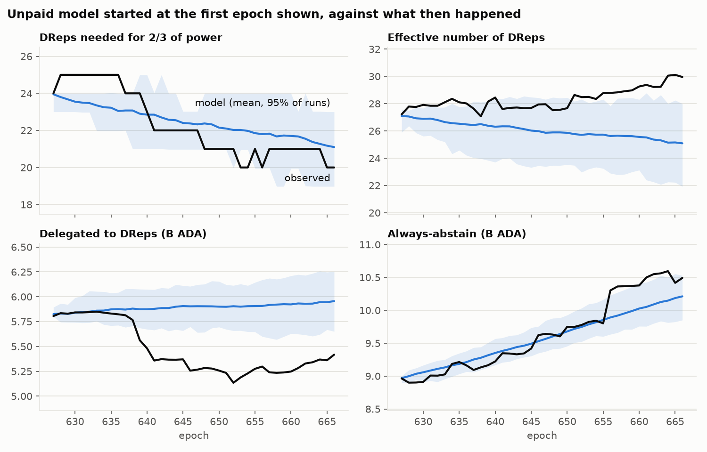
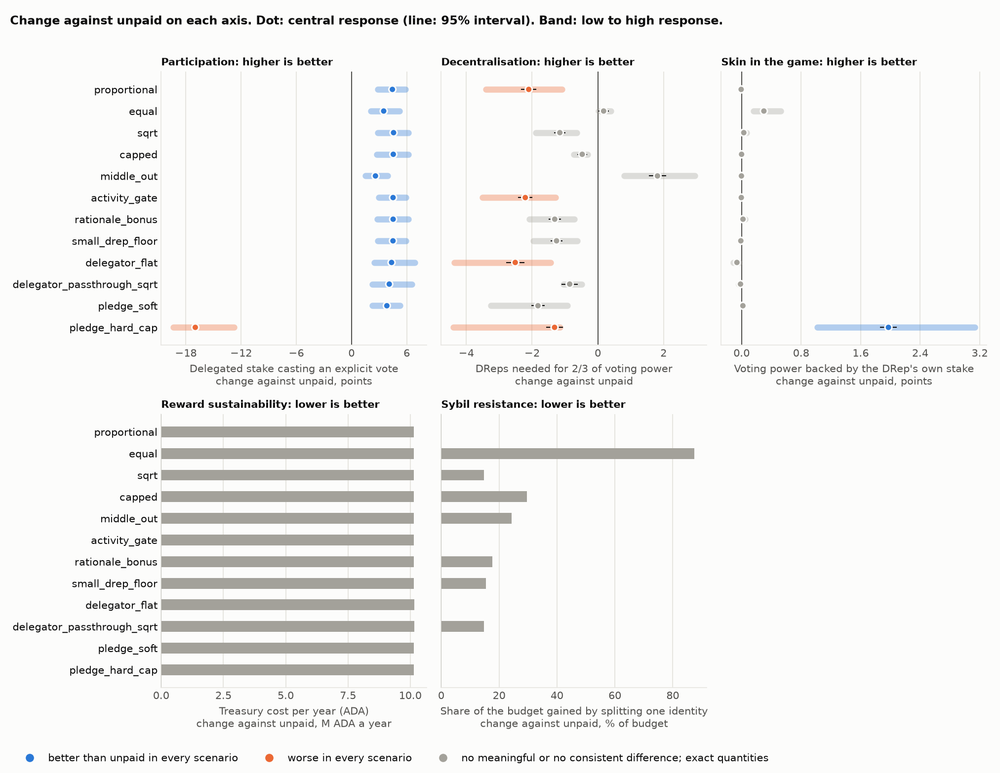
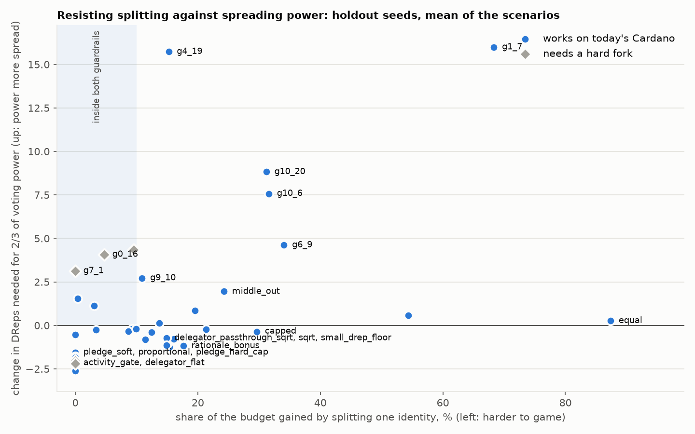

# RSS-Gov results

Chain data to epoch 666. Default programme: 5,000,000 ADA over 36 epochs. Regenerate with `rss-gov all`; method in `METHODS.md`. Interactive charts: `site/index.html` in this folder.

## The chain today

- 848 DReps hold voting power; 20 of them hold two thirds of it (effective number 30.0).
- 5.42B ADA is delegated to DReps, 10.49B to always-abstain and 0.13B to always-no-confidence.
- 158 governance actions have closed; 30,299 DRep ballots.
- Accounts that funded a DRep's registration or that it declares as its payment address hold 50.7M ADA in total, for 828 of 848 DReps. That backs **0.87%** of DRep voting power: the average vote is cast with about 115 times the voter's own stake.

## How schemes are compared

Every scheme starts from the same chain snapshot, runs on the same random seeds, and pays only for explicit votes (Yes, No and Abstain count alike). Named schemes get the same budget. Each is then measured on one axis per objective family; nothing is folded into a single score.

| family | measure | better | meaningful change | what the number rests on | how a real programme would show it |
|---|---|---|---|---|---|
| Participation | Delegated stake casting an explicit vote | higher | 1 points | simulated; rests on the voting and yield responses | on chain: votes and delegation each epoch |
| Decentralisation | DReps needed for 2/3 of voting power | higher | 1 | simulated; rests on the yield and reinvestment responses | on chain: DRep voting power each epoch |
| Skin in the game | Voting power backed by the DRep's own stake | higher | 0.2 points | starts from accounts linked on chain; changes rest on the own-stake response | needs DReps to declare their accounts and sign for them |
| Reward sustainability | Treasury cost per year (ADA) | lower | 0.5 M ADA a year | accounting; exact for a given budget | the programme's own books |
| Sybil resistance | Share of the budget gained by splitting one identity | lower | 2 % of budget | exact property of the formula on today's DReps | indirectly: new look-alike DReps and delegation splits |

A change smaller than `meaningful change` counts as no difference even when it is statistically clear. Marks in the tables: ▲ better than unpaid in every response scenario, ▼ worse in every one, △ / ▽ better / worse in some. No mark: no meaningful difference.

## Does the unpaid model reproduce history?

Fitted on epochs 587–626, started from the observed state at epoch 626, and compared with epochs 627–666 (40 runs). **Every gated check passed.**

| metric | observed | simulated | low | high | error | kind | tolerance | result |
|---|---|---|---|---|---|---|---|---|
| tau67 | 22.300 | 22.455 | 21.055 | 23.779 | +0.007 | relative | 0.150 | pass |
| effective_n | 28.317 | 26.061 | 24.086 | 27.991 | -0.080 | relative | 0.150 | pass |
| drep_power (B ADA) | 5.417 | 5.956 | 5.651 | 6.254 | +0.099 | relative | 0.100 | pass |
| abstain (B ADA) | 10.492 | 10.212 | 9.851 | 10.529 | -0.027 | relative | 0.100 | pass |
| dreps | 848.000 | 802.825 | 764.975 | 830.100 | -0.053 | relative | 0.100 | pass |
| turnover | 0.010 | 0.007 | 0.006 | 0.008 | -0.355 | relative | 0.500 | pass |
| turnout | 0.790 | 0.791 | 0.758 | 0.817 | +0.000 | absolute | 0.050 | pass |
| supported_ratified | 0.750 | 0.766 | 0.600 | 1.000 | +0.016 | absolute | 0.150 | pass |
| ratified | 0.500 | 0.696 | 0.532 | 0.850 | +0.196 | absolute |  | context |
| ballots | 172.797 | 197.267 | 183.617 | 207.731 | +0.142 | relative | 0.200 | pass |

`error` is relative unless `kind` says absolute. `context` rows depend on which proposals get submitted, which the model takes from history rather than predicts.

## What each formula does to today's DReps (no behaviour change)

Exact arithmetic on the current snapshot. `outsider's take` is the share of the budget an outsider gets by bringing 1,000,000 ADA and voting on everything, using as many fake DReps as pays best; the next column is how much of that comes from splitting rather than from simply taking part. `insider split gain` is the most any existing DRep adds by splitting into 2–20 DReps with its delegators following (an upper bound: delegators may not follow). The Sybil axis is the larger of the two splitting gains. `dust claims` is the share of delegator claims below 5 ADA over the programme.

| scheme | rule | DReps paid | largest award / epoch | to 10 largest | outsider's take | of which from splitting | insider split gain | voting power kept | dust claims |
|---|---|---|---|---|---|---|---|---|---|
| proportional | linear; 5M ADA | 193 | 18,907 | 55% | 0% | 0% | 0% | 100% |  |
| equal | equal; 5M ADA | 193 | 1,030 | 5% | 88% | 87% | 12% | 100% |  |
| sqrt | stake^0.5; 5M ADA | 193 | 7,445 | 28% | 5% | 5% | 15% | 100% |  |
| capped | linear, cap 20M; 5M ADA | 193 | 3,181 | 16% | 0% | 0% | 30% | 100% |  |
| middle_out | equal, skip top 10, pay 100; 5M ADA | 100 | 1,862 | 0% | 1% | 0% | 24% | 100% |  |
| activity_gate | linear, gate 70%; 5M ADA | 102 | 20,907 | 54% | 0% | 0% | 0% | 100% |  |
| rationale_bonus | stake^0.5, rationale +100%; 5M ADA | 193 | 9,327 | 29% | 6% | 6% | 18% | 100% |  |
| small_drep_floor | stake^0.5, min 100k, min 10 delegators; 5M ADA | 126 | 7,791 | 29% | 1% | 0% | 15% | 100% |  |
| delegator_flat | linear, 80% to delegators (flat); 5M ADA | 193 | 3,781 | 55% | 0% | 0% | 0% | 100% | 67% |
| delegator_passthrough_sqrt | stake^0.5, 80% to delegators (passthrough); 5M ADA | 193 | 1,489 | 28% | 5% | 5% | 15% | 100% | 70% |
| pledge_soft | linear, reward cap 1000x own stake; 5M ADA | 186 | 33,810 | 48% | 0% | 0% | 0% | 100% |  |
| pledge_hard_cap | linear, power cap 1000x own stake; 5M ADA | 186 | 33,810 | 48% | 0% | 0% | 0% | 18% |  |
| capped_1m | linear, cap 20M; 1M ADA | 193 | 636 | 16% | 0% | 0% | 30% | 100% |  |
| capped_2m5 | linear, cap 20M; 2.5M ADA | 193 | 1,591 | 16% | 0% | 0% | 30% | 100% |  |
| capped_10m | linear, cap 20M; 10M ADA | 193 | 6,362 | 16% | 0% | 0% | 30% | 100% |  |

## Scorecard: named schemes at the same budget

100 seeds per scheme and scenario. Unpaid baseline: Delegated stake casting an explicit vote 25.3 points; DReps needed for 2/3 of voting power 19.6; Voting power backed by the DRep's own stake 0.99 points. Cells are the change against unpaid in the `central` scenario ± 95%; the marks use all of `low`, `central`, `high`.

| scheme | Participation (points) | Decentralisation (DReps) | Skin in the game (points) | Reward sustainability (M ADA a year) | Sybil resistance (% of budget) |
|---|---|---|---|---|---|
| proportional | +4.4 ± 0.1 ▲ | -2.1 ± 0.2 ▼ | -0.01 ± 0.01 | 10.1M | 0% |
| equal | +3.5 ± 0.1 ▲ | +0.2 ± 0.2 | +0.30 ± 0.05 △ | 10.1M | 87% |
| sqrt | +4.6 ± 0.1 ▲ | -1.2 ± 0.2 ▽ | +0.03 ± 0.02 | 10.1M | 15% |
| capped | +4.5 ± 0.1 ▲ | -0.5 ± 0.2 | +0.00 ± 0.01 | 10.1M | 30% |
| middle_out | +2.6 ± 0.1 ▲ | +1.8 ± 0.3 △ | -0.00 ± 0.00 | 10.1M | 24% |
| activity_gate | +4.5 ± 0.1 ▲ | -2.2 ± 0.2 ▼ | -0.00 ± 0.01 | 10.1M | 0% |
| rationale_bonus | +4.5 ± 0.1 ▲ | -1.3 ± 0.2 ▽ | +0.02 ± 0.02 | 10.1M | 18% |
| small_drep_floor | +4.5 ± 0.1 ▲ | -1.3 ± 0.2 ▽ | -0.01 ± 0.00 | 10.1M | 15% |
| delegator_flat | +4.4 ± 0.1 ▲ | -2.5 ± 0.3 ▼ | -0.06 ± 0.01 | 10.2M | 0% |
| delegator_passthrough_sqrt | +4.1 ± 0.1 ▲ | -0.9 ± 0.3 ▽ | -0.01 ± 0.02 | 10.2M | 15% |
| pledge_soft | +3.8 ± 0.1 ▲ | -1.8 ± 0.2 ▽ | +0.02 ± 0.01 | 10.1M | 0% |
| pledge_hard_cap | -17.0 ± 0.2 ▼ | -1.3 ± 0.3 ▼ | +1.97 ± 0.11 ▲ | 10.1M | 0% |

### Which assumption each result rests on

Each column switches on one response channel at its central strength and leaves the others off. A scheme whose result comes from one channel stands or falls with that assumption. With every channel off, paying changes nothing (a hard cap on voting power excepted).

Participation: change in Delegated stake casting an explicit vote (points)

| scheme | voting only | yield only | reinvest only | pledge only | central |
|---|---|---|---|---|---|
| proportional | +4.3 | +0.0 | +0.2 | +0.0 | +4.4 |
| equal | +3.4 | +0.0 | +0.2 | +0.0 | +3.5 |
| sqrt | +4.4 | +0.0 | +0.2 | +0.0 | +4.6 |
| capped | +4.4 | +0.0 | +0.2 | +0.0 | +4.5 |
| middle_out | +2.5 | +0.0 | +0.1 | +0.0 | +2.6 |
| activity_gate | +4.3 | +0.0 | +0.4 | +0.0 | +4.5 |
| rationale_bonus | +4.4 | +0.0 | +0.2 | +0.0 | +4.5 |
| small_drep_floor | +4.4 | +0.0 | +0.2 | +0.0 | +4.5 |
| delegator_flat | +3.1 | +1.0 | +0.2 | +0.0 | +4.4 |
| delegator_passthrough_sqrt | +3.1 | +0.8 | +0.2 | +0.0 | +4.1 |
| pledge_soft | +2.1 | +0.0 | -0.0 | +0.0 | +3.8 |
| pledge_hard_cap | -20.2 | -21.5 | -21.1 | -18.7 | -17.0 |

Decentralisation: change in DReps needed for 2/3 of voting power (DReps)

| scheme | voting only | yield only | reinvest only | pledge only | central |
|---|---|---|---|---|---|
| proportional | -0.0 | +0.0 | -2.2 | +0.0 | -2.1 |
| equal | +0.3 | +0.0 | -0.3 | +0.0 | +0.2 |
| sqrt | +0.2 | +0.0 | -1.4 | +0.0 | -1.2 |
| capped | +0.2 | +0.0 | -0.8 | +0.0 | -0.5 |
| middle_out | +0.5 | +0.0 | +1.2 | +0.0 | +1.8 |
| activity_gate | +0.0 | +0.0 | -2.3 | +0.0 | -2.2 |
| rationale_bonus | +0.1 | +0.0 | -1.4 | +0.0 | -1.3 |
| small_drep_floor | +0.1 | +0.0 | -1.5 | +0.0 | -1.3 |
| delegator_flat | -0.1 | -0.7 | -1.9 | +0.0 | -2.5 |
| delegator_passthrough_sqrt | +0.1 | +0.3 | -1.2 | +0.0 | -0.9 |
| pledge_soft | +0.1 | +0.0 | -0.9 | +0.0 | -1.8 |
| pledge_hard_cap | -12.1 | -12.2 | -13.5 | +0.8 | -1.3 |

Skin in the game: change in Voting power backed by the DRep's own stake (points)

| scheme | voting only | yield only | reinvest only | pledge only | central |
|---|---|---|---|---|---|
| proportional | +0.00 | +0.00 | -0.01 | +0.00 | -0.01 |
| equal | +0.31 | +0.00 | -0.01 | +0.00 | +0.30 |
| sqrt | +0.04 | +0.00 | -0.01 | +0.00 | +0.03 |
| capped | +0.01 | +0.00 | -0.01 | +0.00 | +0.00 |
| middle_out | +0.00 | +0.00 | -0.00 | +0.00 | -0.00 |
| activity_gate | +0.00 | +0.00 | -0.01 | +0.00 | -0.00 |
| rationale_bonus | +0.02 | +0.00 | -0.01 | +0.00 | +0.02 |
| small_drep_floor | -0.00 | +0.00 | -0.01 | +0.00 | -0.01 |
| delegator_flat | -0.00 | -0.06 | -0.01 | +0.00 | -0.06 |
| delegator_passthrough_sqrt | +0.01 | -0.02 | -0.00 | +0.00 | -0.01 |
| pledge_soft | +0.01 | +0.00 | +0.00 | +0.01 | +0.02 |
| pledge_hard_cap | +4.58 | +4.66 | +4.03 | +2.03 | +1.97 |

### What more money buys

The `capped` rule at four budgets, `central` scenario. The response to a reward is assumed to grow with its logarithm, so doubling the budget buys much less than double.

| scheme | cost a year | share of treasury | Participation | Decentralisation | ADA a year per point of participation |
|---|---|---|---|---|---|
| capped_1m | 2.0M | 0.15% | +3.1 ± 0.1 | -0.5 ± 0.1 | 644,966 |
| capped_2m5 | 5.1M | 0.36% | +4.0 ± 0.1 | -0.5 ± 0.1 | 1,278,398 |
| capped | 10.1M | 0.73% | +4.5 ± 0.1 | -0.5 ± 0.2 | 2,232,380 |
| capped_10m | 20.3M | 1.45% | +5.0 ± 0.1 | -0.5 ± 0.2 | 4,047,118 |

## Search over the scheme family

230 designs simulated over 10 generations, with the budget as one of the searched parameters. The finalists were re-run on 100 seeds the search never saw; all numbers here are from those seeds, averaged over `low`, `central`, `high`. Marks: ▲ better than unpaid in every scenario, ▼ worse in at least one.

- 27 of 44 finalists are unbeaten: no other design is at least as good on all 5 axes.
- Guardrails: splitting an identity may gain at most 10% of the budget, and no axis other than cost may be worse than unpaid in any scenario. **7 of 44 finalists stay inside both.**
- Hypervolume of the front (progress measure, in the units of `axes.scale`): **0.01912** (95% 0.01870–0.01952); unpaid alone 0.00455. The search adds **0.00964** over the named schemes (95% 0.00941–0.00986).

### Shortlist: inside every guardrail and unbeaten

| scheme | rule | Participation | Decentralisation | Skin in the game | Reward sustainability | Sybil resistance |
|---|---|---|---|---|---|---|
| g10_2 | linear, cap 2M, pay 200, 50% to delegators (flat); 2.5M ADA | +3.4 ± 0.1 ▲ | -0.2 ± 0.2 | -0.02 ± 0.00 | 5.1M | 9% |
| g10_9 | stake^0.5, cap 2M, pay 200, min 5 delegators, 50% to delegators (flat); 10M ADA | +5.7 ± 0.1 ▲ | -0.4 ± 0.2 | -0.08 ± 0.01 | 20.3M | 9% |
| g7_20 | linear, cap 2M, pay 200, min 10 delegators, gate 75%, 50% to delegators (flat), reward cap 100x own stake; 1M ADA | +2.2 ± 0.1 ▲ | -0.5 ± 0.2 | +0.13 ± 0.00 | 2.0M | 0% |
| g9_18 | linear, cap 10M, skip top 10, min 100k, min 5 delegators, gate 75%, reward cap 1000x own stake; 2.5M ADA | +1.8 ± 0.1 | +1.1 ± 0.2 | +0.00 ± 0.00 | 5.1M | 3% |
| g9_19 | linear, skip top 20, pay 400, min 25 delegators, gate 75%, rationale +50%, 25% to delegators (passthrough), reward cap 100x own stake; 1M ADA | +0.9 ± 0.1 | +1.6 ± 0.2 | +0.01 ± 0.00 | 2.0M | 0% |

By response scenario:

| scheme | Participation (low) | Participation (central) | Participation (high) | Decentralisation (low) | Decentralisation (central) | Decentralisation (high) |
|---|---|---|---|---|---|---|
| g10_2 | +1.8 | +3.2 | +5.3 | -0.2 | -0.3 | -0.2 |
| g10_9 | +3.1 | +5.4 | +8.6 | -0.3 | -0.5 | -0.3 |
| g7_20 | +1.2 | +2.0 | +3.2 | -0.3 | -0.5 | -0.8 |
| g9_18 | +1.0 | +1.7 | +2.6 | +0.5 | +0.9 | +2.0 |
| g9_19 | +0.4 | +0.8 | +1.6 | +0.6 | +1.1 | +3.0 |

### Accepting a cost in decentralisation

4 unbeaten among the finalists that give up exactly this.

| scheme | rule | Participation | Decentralisation | Skin in the game | Reward sustainability | Sybil resistance |
|---|---|---|---|---|---|---|
| g6_10 | linear, cap 2M, pay 200, min 10 delegators, gate 75%, 50% to delegators (flat), reward cap 100x own stake; 10M ADA | +5.3 ± 0.1 ▲ | -1.5 ± 0.2 ▼ | +0.05 ± 0.01 | 20.3M | 0% |
| g7_23 | linear, cap 10M, pay 400, min 25 delegators, gate 75%, rationale +50%, 80% to delegators (flat), reward cap 1000x own stake; 5M ADA | +4.1 ± 0.1 ▲ | -1.8 ± 0.2 ▼ | -0.07 ± 0.01 | 10.2M | 0% |
| g10_18 | linear, cap 50M, min 10k, rationale +200%, 25% to delegators (passthrough), reward cap 100x own stake; 2.5M ADA | +3.4 ± 0.1 ▲ | -1.8 ± 0.2 ▼ | +0.18 ± 0.00 | 5.1M | 0% |
| g5_0 | linear, pay 100, min 5 delegators, gate 50%, rationale +50%, 25% to delegators (flat); 1M ADA | +3.2 ± 0.1 ▲ | -2.1 ± 0.2 ▼ | -0.01 ± 0.00 | 2.0M | 0% |

By response scenario:

| scheme | Participation (low) | Participation (central) | Participation (high) | Decentralisation (low) | Decentralisation (central) | Decentralisation (high) |
|---|---|---|---|---|---|---|
| g6_10 | +3.0 | +5.0 | +7.9 | -1.2 | -1.5 | -1.9 |
| g7_23 | +2.2 | +3.9 | +6.4 | -1.0 | -1.7 | -2.6 |
| g10_18 | +1.8 | +3.3 | +5.0 | -0.8 | -1.6 | -2.8 |
| g5_0 | +1.8 | +3.1 | +4.5 | -1.0 | -1.9 | -3.3 |

### Accepting a cost in sybil resistance

14 unbeaten among the finalists that give up exactly this; the 10 that are hardest to game by splitting are shown.

| scheme | rule | Participation | Decentralisation | Skin in the game | Reward sustainability | Sybil resistance |
|---|---|---|---|---|---|---|
| g1_14 | linear, cap 2M, pay 200, min 10 delegators, gate 75%, 50% to delegators (flat); 10M ADA | +6.1 ± 0.1 ▲ | -0.8 ± 0.2 | -0.09 ± 0.01 | 20.3M | 11% |
| g9_10 | linear, skip top 20, pay 400, min 25 delegators, gate 75%, rationale +50%, 25% to delegators (flat), reward cap 100x own stake; 2.5M ADA | +1.5 ± 0.1 | +2.7 ± 0.2 | -0.01 ± 0.00 | 5.1M | 11% |
| g7_16 | stake^0.25, cap 10M, min 1M, min 5 delegators, rationale +50%, 50% to delegators (flat); 5M ADA | +4.5 ± 0.1 ▲ | -0.4 ± 0.2 | -0.05 ± 0.01 | 10.2M | 12% |
| g10_0 | equal, cap 2M, min 100k, reward cap 100x own stake; 5M ADA | +3.8 ± 0.1 ▲ | +0.1 ± 0.1 | +0.20 ± 0.00 | 10.1M | 14% |
| g4_19 | stake^0.25, cap 50M, skip top 20, min 100k, gate 25%, 80% to delegators (passthrough), reward cap 1000x own stake; 10M ADA | +5.4 ± 0.1 ▲ | +15.7 ± 0.4 ▲ | -0.14 ± 0.01 | 20.3M | 15% |
| g9_20 | linear, cap 10M, min 100k, gate 25%, rationale +200%, 25% to delegators (passthrough), reward cap 100x own stake; 10M ADA | +4.8 ± 0.1 ▲ | -0.2 ± 0.2 | +0.15 ± 0.01 | 20.3M | 21% |
| middle_out | equal, skip top 10, pay 100; 5M ADA | +2.7 ± 0.1 ▲ | +1.9 ± 0.2 | -0.00 ± 0.00 | 10.1M | 24% |
| capped_2m5 | linear, cap 20M; 2.5M ADA | +4.0 ± 0.1 ▲ | -0.4 ± 0.2 | -0.00 ± 0.00 | 5.1M | 30% |
| capped_1m | linear, cap 20M; 1M ADA | +3.3 ± 0.1 ▲ | -0.4 ± 0.2 | -0.00 ± 0.00 | 2.0M | 30% |
| g10_6 | stake^0.25, cap 50M, skip top 20, min 10k, gate 50%, rationale +100%, 25% to delegators (passthrough); 10M ADA | +3.7 ± 0.1 ▲ | +7.6 ± 0.2 ▲ | +0.15 ± 0.05 | 20.3M | 32% |

By response scenario:

| scheme | Participation (low) | Participation (central) | Participation (high) | Decentralisation (low) | Decentralisation (central) | Decentralisation (high) |
|---|---|---|---|---|---|---|
| g1_14 | +3.6 | +5.9 | +9.0 | -0.8 | -0.9 | -0.7 |
| g9_10 | +0.8 | +1.4 | +2.5 | +1.0 | +2.2 | +4.9 |
| g7_16 | +2.5 | +4.3 | +6.8 | -0.3 | -0.4 | -0.5 |
| g10_0 | +2.2 | +3.7 | +5.5 | +0.0 | +0.2 | +0.2 |
| g4_19 | +2.5 | +4.8 | +8.7 | +5.9 | +13.8 | +27.5 |
| g9_20 | +2.8 | +4.7 | +6.8 | -0.6 | -0.4 | +0.4 |
| middle_out | +1.5 | +2.6 | +3.9 | +0.9 | +1.9 | +3.0 |
| capped_2m5 | +2.4 | +3.9 | +5.7 | -0.2 | -0.4 | -0.5 |
| capped_1m | +1.8 | +3.1 | +4.8 | -0.3 | -0.3 | -0.5 |
| g10_6 | +1.9 | +3.4 | +5.8 | +2.9 | +6.7 | +13.1 |

### Accepting a cost in sybil resistance, decentralisation

2 unbeaten among the finalists that give up exactly this.

| scheme | rule | Participation | Decentralisation | Skin in the game | Reward sustainability | Sybil resistance |
|---|---|---|---|---|---|---|
| delegator_passthrough_sqrt | stake^0.5, 80% to delegators (passthrough); 5M ADA | +4.3 ± 0.1 ▲ | -0.7 ± 0.2 ▼ | -0.02 ± 0.01 | 10.2M | 15% |
| g6_0 | stake^0.25, pay 100, min 5 delegators, 25% to delegators (flat); 1M ADA | +3.1 ± 0.1 ▲ | -0.8 ± 0.2 ▼ | -0.01 ± 0.00 | 2.0M | 16% |

By response scenario:

| scheme | Participation (low) | Participation (central) | Participation (high) | Decentralisation (low) | Decentralisation (central) | Decentralisation (high) |
|---|---|---|---|---|---|---|
| delegator_passthrough_sqrt | +2.3 | +4.0 | +6.6 | -0.4 | -0.6 | -1.1 |
| g6_0 | +1.7 | +3.0 | +4.7 | -0.4 | -0.6 | -1.3 |

### Accepting a cost in sybil resistance, skin in the game

1 unbeaten among the finalists that give up exactly this.

| scheme | rule | Participation | Decentralisation | Skin in the game | Reward sustainability | Sybil resistance |
|---|---|---|---|---|---|---|
| g10_20 | stake^0.25, cap 2M, skip top 20, pay 200, min 10 delegators, gate 75%, 50% to delegators (flat), reward cap 1000x own stake; 10M ADA | +6.5 ± 0.2 ▲ | +8.8 ± 0.3 ▲ | -0.19 ± 0.01 ▼ | 20.3M | 31% |

By response scenario:

| scheme | Participation (low) | Participation (central) | Participation (high) | Decentralisation (low) | Decentralisation (central) | Decentralisation (high) |
|---|---|---|---|---|---|---|
| g10_20 | +3.2 | +5.9 | +10.5 | +4.2 | +8.5 | +13.7 |

### Accepting a cost in participation (needs a hard fork)

2 unbeaten among the finalists that give up exactly this.

| scheme | rule | Participation | Decentralisation | Skin in the game | Reward sustainability | Sybil resistance |
|---|---|---|---|---|---|---|
| g7_1 | linear, cap 200M, min 100k, gate 25%, rationale +50%, 50% to delegators (flat), power cap 100x own stake; 2.5M ADA | -19.4 ± 0.2 ▼ | +3.1 ± 0.2 | +4.18 ± 0.19 ▲ | 5.1M | 0% |
| g0_16 | linear, cap 50M, skip top 5, 25% to delegators (passthrough), power cap 100x own stake; 2.5M ADA | -19.4 ± 0.2 ▼ | +4.1 ± 0.2 ▲ | +4.16 ± 0.19 ▲ | 5.1M | 5% |

By response scenario:

| scheme | Participation (low) | Participation (central) | Participation (high) | Decentralisation (low) | Decentralisation (central) | Decentralisation (high) |
|---|---|---|---|---|---|---|
| g7_1 | -22.5 | -20.2 | -15.6 | +6.2 | +3.0 | +0.2 |
| g0_16 | -22.5 | -20.2 | -15.7 | +6.5 | +3.9 | +1.8 |

### Accepting a cost in participation, decentralisation (needs a hard fork)

1 unbeaten among the finalists that give up exactly this.

| scheme | rule | Participation | Decentralisation | Skin in the game | Reward sustainability | Sybil resistance |
|---|---|---|---|---|---|---|
| g1_17 | linear, power cap 1000x own stake; 1M ADA | -16.7 ± 0.2 ▼ | -2.0 ± 0.3 ▼ | +1.98 ± 0.12 ▲ | 2.0M | 0% |

By response scenario:

| scheme | Participation (low) | Participation (central) | Participation (high) | Decentralisation (low) | Decentralisation (central) | Decentralisation (high) |
|---|---|---|---|---|---|---|
| g1_17 | -19.6 | -17.3 | -13.2 | -4.1 | -1.0 | -1.0 |

### Where the named schemes end up

| scheme | gives up | unbeaten among designs giving up the same |
|---|---|---|
| capped_2m5 | sybil resistance | yes |
| middle_out | sybil resistance | yes |
| activity_gate | decentralisation | no |
| capped | sybil resistance | no |
| capped_10m | sybil resistance | no |
| capped_1m | sybil resistance | yes |
| delegator_flat | decentralisation | no |
| delegator_passthrough_sqrt | sybil resistance, decentralisation | yes |
| equal | sybil resistance | no |
| pledge_hard_cap | participation, decentralisation | no |
| pledge_soft | decentralisation | no |
| proportional | decentralisation | no |
| rationale_bonus | sybil resistance, decentralisation | no |
| small_drep_floor | sybil resistance, decentralisation | no |
| sqrt | sybil resistance, decentralisation | no |

The guardrails are judgement calls in `config.yaml`. Moving one and running `rss-gov report` regroups these tables without simulating anything.

## How to read this

- The unpaid world is fitted to chain history and tested on held-out epochs. How people react to money is **assumed**: four response channels, each at low, central and high strength. A result that holds only in `high` is a hope, not a finding.
- Cost and the gain from splitting are exact for a given formula. The other axes are conditional on the response assumptions.
- Own stake comes from accounts linked to a DRep on chain (the funder of its registration, its declared payment address). That misses own stake held elsewhere and can count stake that is not the DRep's. A real programme needs signed declarations.
- A hard cap on voting power is simulated mechanically: delegators of a capped DRep are not modelled as moving away, so its cost in participation is an upper bound.
- Differences smaller than their ± are not differences.
- Only real-world data can measure the responses. `METHODS.md` describes how a programme could be set up to measure them.
